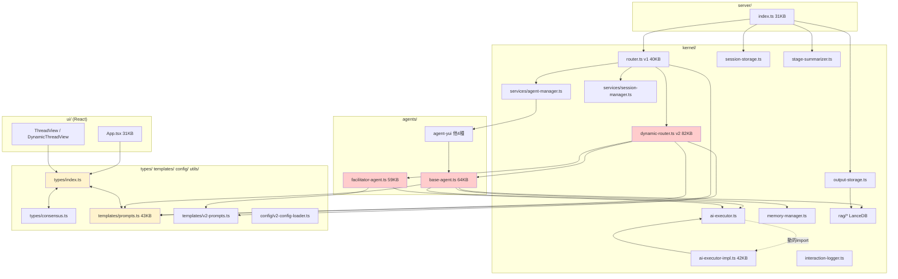

# Yui Protocol リファクタリング計画書

> 作成日: 2026-06-10
> 対象: `src/` 全体(48ファイル)+ `scripts/` + `tests/`
> 方法: 全ソースファイルの import 文と実装を読み、ファイル単位の有向依存グラフを構築して分析。
> **本書は分析と提案のみであり、コードへの変更は含まない。**

---

## 1. 現在の依存関係と構造的ボトルネック

### 1.1 依存グラフ(俯瞰)

意図されている層構造は「types → templates/config/utils → kernel → agents → server/ui」だが、
実際の import グラフは以下のように**双方向の矢印**を複数含む。



赤 = God Object、黄 = 循環依存の当事者、点線 = 動的 import。

### 1.2 循環依存(Circular Dependencies)

| # | 循環 | 実体 | 深刻度 |
|---|------|------|--------|
| C1 | `types/index.ts` ⇄ `templates/prompts.ts` | `types/index.ts:1` が `Language` を prompts から import し再export。一方 `prompts.ts:2` は `DialogueStage` を types から import。**型定義の基盤層がプロンプトテンプレート層に依存**している。`Language` は `'en' \| 'ja'` の2値型に過ぎないのに、これを介して UI(`ui/*.tsx` → `types/index`)からもサーバ全域からも 43KB の prompts.ts への参照が張られる。 | **高** |
| C2 | `types/index.ts` ⇄ `types/consensus.ts` | `consensus.ts` が `Message` を index から import、`index.ts:2` が `FacilitatorLog` を consensus から import(こちらは `import type` のため実行時は無害だが、構造としては循環)。 | 中 |
| C3 | `kernel/` ⇄ `agents/`(パッケージレベル) | `kernel/dynamic-router.ts` → `agents/base-agent.ts`・`agents/facilitator-agent.ts`、`kernel/services/agent-manager.ts` → 具象エージェント5種。逆方向に `agents/base-agent.ts` → `kernel/ai-executor.ts`・`kernel/memory-manager.ts`・`kernel/interaction-logger.ts`・`kernel/rag/rag-retriever.ts`。**「kernel が agents を駆動し、agents が kernel のインフラを使う」両方向依存**で、どちらの層も単独でテスト・差し替えできない。 | **高** |
| C4 | `kernel/ai-executor.ts` ⇄ `kernel/ai-executor-impl.ts` | impl が抽象クラスを import、抽象側が `await import('./ai-executor-impl.js')` で実装を取得(`ai-executor.ts:114`)。動的 import で実害は回避済みだが、「抽象が実装を知っている」点は依存性逆転の原則違反。フォールバックの MockExecutor が抽象層に同居している。 | 低(意図的) |

### 1.3 God Object / God File

| ファイル | サイズ | 抱えている責務 |
|---------|-------|--------------|
| `kernel/dynamic-router.ts` | 82KB / 約2,100行 | ①対話ループ制御 ②コンセンサス収集・パース(`parseConsensusResponse`) ③ファシリテーターアクション実行(deep_dive/clarification/perspective_shift/summarize/redirect 各メソッド) ④投票によるファイナライザ選出(`selectFinalizerByVoting`/`parseVoteResponse`) ⑤協調ファイナライズ(`handleMultipleFinalizers`) ⑥WebSocket 送出 ⑦セッション永続化 ⑧発言バランス管理 ⑨メッセージ整形 — 少なくとも9責務 |
| `agents/base-agent.ts` | 64KB / 約1,650行 | ①エージェント実行(stage1〜5_1) ②AIExecutor 2系統のライフサイクル管理 ③環境変数からのモデル設定解決 ④信頼度計算ヒューリスティクス(5メソッド) ⑤生成パラメータ計算(temperature/topP/penalty/topK で約400行) ⑥リフレクション・投票・質問のテキストパース(ひらがな→カタカナ変換 `toKatakana` まで内包) ⑦メモリ管理 ⑧RAG 統合 ⑨前シーケンス情報抽出 |
| `agents/facilitator-agent.ts` | 59KB / 約1,400行 | 状態分析・収束判定・介入案生成・沈黙調整・トピックドリフト検出・発言順決定・投票解析(`analyzeFinalizeVotes`)・詳細ログ生成。分析(読み)と介入(書き)と記録(ログ)が混在 |
| `templates/prompts.ts` | 43KB | プロンプト文字列(データ)と `parseVotes`/`extractVoteDetails` 等のパースロジック(コード)が同居。`Language` 型の定義元でもある(C1の原因) |
| `kernel/ai-executor-impl.ts` | 42KB | 7プロバイダ(OpenAI/Anthropic/Gemini/Gemini-CLI/Ollama/llama.cpp×2)+Mock を1ファイルに格納 |
| `kernel/router.ts` | 40KB | v1 ステージ実行 + 投票集計(`extractVote`/`tallyVotes`)+サマライザ選出+ステージ履歴管理+出力保存+ **v2 への委譲(`startDynamicSession*`)** |
| `server/index.ts` | 31KB | Express 設定+WebSocket 接続管理+**v1 ステージ進行のビジネスルール**+SSE+全ルート定義+v2 実行+graceful shutdown |
| `ui/App.tsx` | 31KB | データ取得(fetch 直書き)+セッション状態管理+画面分岐+描画 |
| `types/index.ts` の `Message.metadata` | — | 約50個のオプショナルフィールドを持つ god record。v1 の投票、v2 のファシリテーター、協調ファイナライズ、発言順…と全機能のメタデータが1つの型に堆積し、どの組み合わせが有効か型で表現できない |

### 1.4 レイヤー越え・責務漏れ

1. **v1 → v2 依存**: `router.ts:35,155,185` で `YuiProtocolRouter` が `DynamicDialogueRouter` を生成・保持。CLAUDE.md の設計原則「v1.0 must never break / 並行する2系統」に対し、実態は **v1 が v2 を内包**しており、v2 の変更(コンストラクタ・依存追加)が必ず v1 のコンパイル・初期化に波及する。
2. **HTTP 層にドメインルール**: `server/index.ts:136,159-169` がステージ一覧(9ステージ)と「completedStages >= 8 で新シーケンス」という進行ルールをハードコード。ステージ定義の変更がサーバ層の修正を要求する。
3. **永続化層 → RAG**: `output-storage.ts:4` が `getRAGManager()`(シングルトン)を直接呼び、保存時に副作用としてインデックス化を実行。ストレージ単体テストが RAG 設定に依存する。さらに保存した Markdown を**正規表現でパースしてメタデータを復元**(`parseMarkdownContent`)しており、フォーマット変更で読み込みが壊れる往復変換の脆さがある。
4. **抽象層がプロンプト内容を知っている**: `ai-executor.ts:126` の Mock フォールバックが `'STAGE 5 - OUTPUT GENERATION'` という v1 プロンプトの文言や投票表記を知っている。AI 実行抽象が対話プロトコルの詳細に依存。
5. **UI に API クライアント層がない**: `App.tsx` / `ThreadView.tsx` / `DynamicThreadView.tsx` が `fetch` と Socket.IO 接続を各自で直接管理。エンドポイント URL・イベント名の文字列が UI コンポーネントに分散。
6. **エージェントロースターの多重ハードコード**: `eiro-001, yui-000, hekito-001, yoga-001, kanshi-001` の ID(および日本語名)が少なくとも5箇所に重複 — `services/agent-manager.ts:45-49`(登録)、`facilitator-agent.ts:18`(`AGENT_NAMES`)、`dynamic-router.ts:1539-1545`(`getFinalizerFocus`)、`dynamic-router.ts:1724`(`getParticipationBalance`)、`dynamic-router.ts:2044-`(`getAgentName` の ID→名前テーブル)。エージェント追加時に5箇所の修正が必要で、`/create-agent` スキルの前提を壊しやすい。
7. **設定と実装の乖離**: `dynamic-router.ts:41` で `convergenceThreshold` を config から読み込むが、収束判定(`dynamic-router.ts:169-172`)は `7.0` / `8.0` / `round >= 3` の**ハードコード値**を使用しており、`config/v2-settings.json` の `convergenceThreshold` は実質無効。
8. **DI の中途半端さ**: `YuiProtocolRouter` は `agentManager`/`sessionManager` をオプション引数で受けつつ、`DynamicDialogueRouter`・`FacilitatorAgent`・`StageSummarizer` は内部で `new` する。インターフェース `IRealtimeRouter`/`IAgentManager`/`ISessionManager`(`kernel/interfaces.ts`)は存在するが、`server/index.ts` は具象 `YuiProtocolRouter` に直接依存。`ISessionManager.getSessionStorage(): any` は抽象の漏れ。

### 1.5 死蔵コード・重複(リファクタリングを阻害する負債)

- **空ファイル**: `kernel/session-manager.ts` は1バイト(空白のみ)。実体は `kernel/services/session-manager.ts` にあり、紛らわしい。
- **未配線のメモリ階層**: `memory-manager.ts` の `ConversationMemoryManager` は**中身が空のスタブ**(コンストラクタのみ)。本実装の `MemoryManager`(AI 圧縮・階層化、約240行)は**どこからも import されていない**。`BaseAgent.prepareContext()` は固定の `slice(-5)` で代替しており、CLAUDE.md の「hierarchical memory compression」は現状動作していない。
- **重複実装**:
  - `removeCircularReferences` — `session-storage.ts:9`(export 版)と `router.ts:53`(private 版、微妙に挙動が異なる)
  - `getPreviousSequenceInfo` — `services/session-manager.ts:255` と `base-agent.ts:140`(別ロジックで同目的)
  - `StageSummary` 型 — `types/index.ts:259` と `stage-summarizer.ts:14`
  - `shuffleArray` — `router.ts:42` と `facilitator-agent.ts:96`
  - **投票解析が5系統**: `prompts.ts` の `parseVotes`/`extractVoteDetails`(正規表現)、`router.ts` の `extractVote`/`tallyVotes`、`stage-summarizer.ts` の `analyzeVotes`(AI ベース)、`dynamic-router.ts` の `parseVoteResponse`、`facilitator-agent.ts` の `analyzeFinalizeVotes`(AI ベース)
- コメントアウトされた outputs API 一式(`server/index.ts:593-650`)。

---

## 2. アーキテクチャ方針(密結合の解消と関心の分離)

### 2.1 目標とする層構造(依存は上→下の一方向のみ)

```
┌─────────────────────────────────────────────┐
│ interface 層    server/ (routes, ws)  ui/   │  ← HTTP/WS/画面。ドメインルールを持たない
├─────────────────────────────────────────────┤
│ application 層  orchestration/              │  ← v1 router / v2 router / 進行オーケストレータ
│                 (v1 と v2 は兄弟。相互参照禁止) │
├─────────────────────────────────────────────┤
│ domain 層       agents/  dialogue/          │  ← エージェント、コンセンサス、投票、収束判定
│                 (ポート=interface のみに依存)  │
├─────────────────────────────────────────────┤
│ infrastructure 層  llm/ storage/ rag/ log/  │  ← AIExecutor 実装、ファイル永続化、LanceDB
├─────────────────────────────────────────────┤
│ foundation 層   types/ config/ prompts(データ)│  ← 何にも依存しない
└─────────────────────────────────────────────┘
            ↑ 配線は composition root (server 起動時) が一手に担う
```

### 2.2 方針

1. **型の独立**(C1/C2 対策): `Language` を `types/` に移動し、`templates/prompts.ts` が types を参照する一方向にする。`types/index.ts` から templates への import を全廃。foundation 層は「import するだけで副作用ゼロ・依存ゼロ」を不変条件とする。
2. **ポート&アダプタで kernel ⇄ agents を切断**(C3 対策): ルーターが必要とするエージェント操作を `DialogueAgent` インターフェース(既存の `AgentInstance` を拡張)として domain 契約に定義し、`DynamicDialogueRouter` は `BaseAgent` 具象型ではなくこのポートに依存させる。逆方向は、`BaseAgent` が使うインフラ(AIExecutor 生成、ロガー、RAG)を**コンストラクタ注入**に統一し、agents → kernel の直接 import を排除する。
3. **composition root の導入**: 具象クラスの `new` と配線(エージェント登録、RAG 初期化、ルーター構築)を `src/bootstrap/` に集約。`AgentManager` のエージェント登録は **registry 設定(エージェント定義の静的リスト1箇所)** から行い、ファシリテーター/ルーター内のハードコード ID テーブルは registry 参照に置換する。エージェントの「名前・focus・色」等のメタ情報は `Agent` 型(各エージェントの config)に既にあるので、それを単一情報源とする。
4. **v1/v2 の対等化**: `YuiProtocolRouter` から `DynamicDialogueRouter` の生成・委譲メソッドを撤去し、server が両ルーターをそれぞれ保持する。共有するのは `SessionStorage`・`AgentRegistry` などの下位サービスのみ。これにより「v1.0 must never break」を依存グラフ上で保証する。
5. **God Object の責務分割**: 「1ファイル=1責務、目安500行以下」を基準に、対話進行(ループ)・判定(収束/投票)・実行(アクション)・通知(イベント)・永続化を別クラスへ。特に **WebSocket 送出は `DialogueEventSink` インターフェース**(`emit(event, payload)`)に抽象化し、ルーターからは sink 呼び出しのみにする(SSE/テスト用 sink も同じ口で実装可能になる)。
6. **投票・コンセンサス解析の一本化**: 5系統ある投票解析を `dialogue/voting/` に集約し、「正規表現ベース」「AI ベース」を同一インターフェース(`VoteParser`)の実装として整理。プロンプト文字列(データ)とパーサ(ロジック)を別ファイルに分離する。
7. **段階的・後方互換**: 各フェーズは `npm run build` → `npm run test` が通る粒度で完結させる。公開 API(REST/WS イベント名、セッション JSON 形式、`outputs/` の Markdown 形式)は全フェーズを通じて変更しない。

---

## 3. 段階的リファクタリング・ロードマップ

> 各フェーズは独立してマージ可能。順序は依存関係順(後のフェーズは前のフェーズの成果を前提とする)。
> 全フェーズ共通の完了条件: `npm run build` 成功、`npm run test` 全件パス、REST/WS の外部仕様不変。

### Phase 1: 足場固め — 型循環の解消と死蔵コードの整理(リスク: 低)

**目的**: foundation 層を依存ゼロにして以降の分割を安全にする。挙動変更なしの純粋な整理。

**対象ファイル**:
- `src/types/index.ts`, `src/types/consensus.ts`, `src/templates/prompts.ts`(`Language` の移設)
- `src/kernel/session-manager.ts`(空ファイル削除)
- `src/kernel/router.ts`, `src/kernel/session-storage.ts`(`removeCircularReferences` の一本化)
- `src/kernel/stage-summarizer.ts`, `src/types/index.ts`(`StageSummary` 型の一本化)
- `src/kernel/memory-manager.ts`, `src/agents/base-agent.ts`(スタブ `ConversationMemoryManager` の扱い決定)

**作業内容**:
1. `Language` 型を `src/types/language.ts`(または `types/index.ts` 直下)に移し、`templates/prompts.ts`・`templates/v2-prompts.ts`・全 import 元を新パスに付け替える(re-export を残せば変更は機械的)。
2. `types/consensus.ts` の `Message` import を `import type` 化し、型レイヤ内の循環を実行時から排除。
3. 空の `kernel/session-manager.ts` を削除。`router.ts` 内の private `removeCircularReferences`/`shuffleArray` を共有ユーティリティ(`session-storage.ts` 版 / 新設 `utils/`)に統一。
4. `ConversationMemoryManager`(空スタブ)と未使用の `MemoryManager` について方針決定: **推奨は「スタブを削除し、`MemoryManager` を Phase 3 で BaseAgent に配線する」**。少なくとも CLAUDE.md の記述と実態の乖離を解消する。
5. `dependency-cruiser`(または `madge --circular`)を devDependency に追加し、CI/テストで循環ゼロを機械的に検証できるようにする。
6. **【コスト/M1】トークン会計の実装**: `SimplifiedInteractionLog` に `tokensUsed`/`promptTokens`/`completionTokens` を追加し、`executeAIWithErrorHandling` 等から `AIExecutionResult.tokensUsed` を引き渡す(現状は取得済みの値を破棄している)。セッション別集計を `/api/v2/stats` に追加し、以降のフェーズの削減効果のベースラインを取る。

**完了条件**:
- `madge --circular src/`(ts 解決込み)の検出が **C4(動的 import)以外ゼロ**。
- `types/` 配下のファイルが `templates/` を import していない。
- 空ファイル・重複ユーティリティが解消されている。
- 1セッション実行後にエージェント/ステージ別のトークン使用量がログと stats API から取得できる。

---

### Phase 2: 境界の確立 — kernel ⇄ agents の切断と composition root(リスク: 中)

**目的**: パッケージレベル循環 C3 を解消し、エージェントロースターを単一情報源化する。

**対象ファイル**:
- `src/kernel/interfaces.ts` → `src/dialogue/contracts.ts`(仮)に拡張(`DialogueAgent` ポート定義)
- `src/kernel/dynamic-router.ts`(`BaseAgent` 具象依存 → ポート依存へ)
- `src/kernel/services/agent-manager.ts` → `src/bootstrap/agent-registry.ts`(移設+registry 化)
- `src/agents/base-agent.ts`(AIExecutor・ロガー・RAG のコンストラクタ注入化)
- `src/agents/facilitator-agent.ts`(`AGENT_NAMES` ハードコード除去)
- `src/kernel/dynamic-router.ts` の ID テーブル3箇所(`getFinalizerFocus`/`getParticipationBalance`/`getAgentName`)
- `src/server/index.ts`(bootstrap 経由の構築に変更)

**作業内容**:
1. ルーターが使うエージェント操作(`getAgent()`, `stage1IndividualThought()`, 自由応答、コンセンサス回答)を `DialogueAgent` インターフェースに定義。`DynamicDialogueRouter` のシグネチャを `Record<string, BaseAgent>` → `Record<string, DialogueAgent>` に変更。
2. `BaseAgent` の `createAIExecutor` 直呼びを `ExecutorFactory` ポートの注入に置換(デフォルト実装は現行と同じ動作)。これで `agents/` から `kernel/` への import は型のみになる。
3. 具象エージェント5種+ファシリテーターの生成を `bootstrap/agent-registry.ts` に集約。各エージェントの `Agent` config(ID・名前・style・focus 文言)を registry の単一情報源とし、`facilitator-agent.ts:18` と `dynamic-router.ts` 内の ID/名前/フォーカス対応表を registry 参照に置換。
4. `server/index.ts` の構築コードを `bootstrap/` に移し、server はインターフェース(`IRealtimeRouter` 等)経由でルーターを受け取る。
5. `ISessionManager.getSessionStorage(): any` を正しい型に修正。
6. **【コスト/M2基盤・M8】`ExecutorFactory` にタスク階層(`TaskTier`)の概念と (agentId, tier) → executor のキャッシュを実装**。`executeAIWithFinalizerModel` の都度 `createAIExecutor`(ローカル LLM ではモデル再ロード)を廃止し、tier ごとのモデル指定を `config/` から読めるようにする(この時点では全 tier が現行モデルを指す=挙動不変)。

**完了条件**:
- dependency-cruiser ルール「`kernel/`(→将来 `orchestration/`)から `agents/` の具象クラスを import しない」「`agents/` から `kernel/` の実装ファイルを import しない(contracts 除く)」がパスする。
- 新エージェントの追加が **registry 1箇所+エージェントファイル1つ**の変更で完結する(ハードコード表の修正が不要)。
- `compatibility-v1-v2.test.ts` を含む既存テストが無修正(または import パス修正のみ)でパスする。

---

### Phase 3: God Object 分解 — dynamic-router / base-agent / facilitator(リスク: 中〜高)

**目的**: v2 中核の3巨大ファイルを責務単位に分割し、変更影響範囲を局所化する。挙動は不変。

**対象ファイル**:
- `src/kernel/dynamic-router.ts`(82KB)→ `src/orchestration/v2/` 配下へ分割
- `src/agents/base-agent.ts`(64KB)→ 協力クラスへ委譲
- `src/agents/facilitator-agent.ts`(59KB)→ 分析/介入/記録に分割
- `src/templates/prompts.ts`(43KB)→ テンプレート(データ)とパーサ(ロジック)を分離

**作業内容**(分割案):
1. `dynamic-router.ts` →
   - `DynamicDialogueRouter`(対話ループのみ、目標 300 行以下)
   - `ConsensusCollector`(`gatherConsensus`/`askForConsensus`/`parseConsensusResponse`)
   - `FacilitatorActionExecutor`(`executeAction(s)`/`askForDeepDive` ほか5アクション)
   - `FinalizationService`(`selectFinalizerByVoting`/`handleMultipleFinalizers`/`getFinalizerFocus`/`getCollaborativeInstructions`)
   - `DialogueEventSink` インターフェース+ Socket.IO 実装(`emitWebSocketEvent` の置換。server 側 `wsEmitter` クロージャを正式な型に)
   - 収束判定を `ConvergenceJudge` に抽出し、**ハードコードされた 7.0/8.0/round≥3 を `config/v2-settings.json` の値に接続**(現状 config が無効になっているバグの修正を兼ねる。デフォルト値は現行ハードコード値に合わせ挙動を維持)
2. `base-agent.ts` →
   - `GenerationParameters`(temperature/topP/penalty/topK 計算の約400行を pure function 群へ)
   - `ConfidenceEstimator`(信頼度ヒューリスティクス5メソッド)
   - `ResponseParsers`(`parseReflectionsFromContent`/`detectAgreement`/`extractQuestions`/`toKatakana` → `dialogue/parsing/` へ)
   - `AgentMemory`(Phase 1 で方針決定した `MemoryManager` をここで配線。`prepareContext` の固定 `slice(-5)` を置換し、CLAUDE.md の「圧縮率30%目標・圧縮過程のログ化」を実態化)
   - `BaseAgent` 本体はステージメソッドとプロンプト組み立てに限定
3. `facilitator-agent.ts` → `DialogueAnalyzer`(読み: 状態分析・パターン検出・ドリフト検出)/`InterventionPlanner`(書き: アクション提案・動的指示生成)/`FacilitatorLogger`(記録)に3分割。
4. `prompts.ts` → `templates/v1-prompts.ts`(文字列定数のみ)+ `dialogue/voting/vote-parser.ts`(`parseVotes`/`extractVoteDetails`)に分離。router の `extractVote`/`tallyVotes` も voting へ移動し、AI ベース解析(`stage-summarizer.analyzeVotes`/`facilitator.analyzeFinalizeVotes`)と合わせて `VoteParser` インターフェースの実装として一本化。
5. **【コスト/M2適用・M3・M4】** `ConsensusCollector`・`FinalizationService` の機械的タスク(満足度確認・投票・発言順決定)を `mechanical` tier の安価モデル+短縮人格プロンプト+`maxTokens` 200〜500+JSON 構造化出力に切り替える(config でオプトイン)。投票解析は **regex-first / AI-fallback** に変更し、正規表現で確定した票は AI 呼び出しをスキップ。
6. **【コスト/M5】** プロンプト組み立てを「静的部(人格+ステージ指示)→ 追記型文脈 → 動的指示」の順に再構成し、Anthropic は `cache_control` 付与、他プロバイダはプレフィックス安定化でプロンプトキャッシュを有効化。
7. **【コスト/M6・M7】** `MemoryManager` 配線(上記2-④)の圧縮呼び出しは `summary` tier で実行。`v2-settings.json` にセッション単位の呼び出し回数/トークンバジェットを追加し、超過時は `ConvergenceJudge` がファシリテーターへ `conclude` を強制する。

**完了条件**:
- 分割後の各ファイルが 500 行以下(目安)。
- 抽出した pure function(生成パラメータ・投票パース・収束判定)に単体テストが追加されている(既存の `generation-parameters.test.ts`/`vote-analysis.test.ts`/`convergence-logic.test.ts` を移設・拡充)。
- `config/v2-settings.json` の `convergenceThreshold` 変更が実際に収束挙動へ反映される(回帰テストで確認)。
- v1(`router.test.ts`)・v2(`compatibility-v1-v2.test.ts`)のテストがパスし、セッション JSON・WS イベント名が不変。
- tier 設定を有効にした v2 セッションで、Phase 1 のトークン会計によりコンセンサス/投票呼び出しが安価モデルに切り替わっていることが確認できる(ベースライン比でセッション総コストの削減を計測・記録)。

---

### Phase 4: interface 層の整理 — server 分割と v1/v2 対等化、UI クライアント層(リスク: 中)

**目的**: HTTP/WS 層からドメインルールを追い出し、v1→v2 依存を断つ。UI に API クライアントを導入する。

**対象ファイル**:
- `src/server/index.ts`(31KB)→ `server/app.ts` + `server/routes/{sessions,realtime,v2,health}.ts` + `server/ws/connection-manager.ts` + `server/ws/session-executor.ts`
- `src/kernel/router.ts`(`startDynamicSession*`/`getDynamicDialogueStats`/`dynamicRouter` フィールドの撤去)
- `src/ui/App.tsx`, `src/ui/ThreadView.tsx`, `src/ui/DynamicThreadView.tsx` → `src/ui/api/client.ts` + `src/ui/api/useSessionSocket.ts` の導入
- `src/kernel/output-storage.ts`(RAG 直結の解消)

**作業内容**:
1. `startSessionExecution` のステージ進行ルール(9ステージ配列・「≥8 で新シーケンス」)を `orchestration/v1/stage-sequencer.ts` へ移動。ステージ一覧は `DialogueStage` 型から導出し、server は「開始要求を受けてオーケストレータを呼ぶ」だけにする。
2. `YuiProtocolRouter` から v2 委譲コードを削除し、server(bootstrap)が `YuiProtocolRouter` と `DynamicDialogueRouter` を**並列に**保持。`/api/v2/*` は後者を直接呼ぶ。
3. ルート定義をリソース別ファイルに分割し、SSE 進捗送出(`onProgress` の整形・truncate 処理)を共通ヘルパへ。
4. UI: fetch 呼び出しを `api/client.ts`(エンドポイントと型を集約)に、Socket.IO 接続とイベント購読を `useSessionSocket` フックに集約。`App.tsx` は状態と画面分岐のみに縮小(目標 300 行)。
5. `OutputStorage` から `getRAGManager()` 直呼びを除去し、保存完了を `onOutputSaved` コールバック(または軽量 EventEmitter)で通知。RAG 自動インデックスは bootstrap で購読配線する。これでストレージ層は RAG 非依存になる。

**完了条件**:
- `server/` 配下に「ステージ一覧」「シーケンス継続判定」のリテラルが存在しない。
- `router.ts` が `dynamic-router` を import していない(dependency-cruiser ルール化)。
- `ui/` 配下で `fetch(`/`io(` を直接呼ぶのは `ui/api/` のみ。
- `server.test.ts`・`output-storage.test.ts` がパスし、REST レスポンス・WS/SSE イベントの互換が保たれる。

---

### Phase 5: 横断的関心の型安全化と仕上げ(リスク: 低〜中)

**目的**: 残存する暗黙結合(metadata・設定・ロギング)を整理し、リファクタリング後の構造を固定化する。

**対象ファイル**:
- `src/types/index.ts`(`Message.metadata` の分解)
- `src/kernel/ai-executor-impl.ts`(プロバイダ別ファイル化)
- `src/kernel/ai-executor.ts`(Mock の v1 プロンプト知識の除去)
- `src/config/`(`V2ConfigLoader`/`RAGConfig` のアクセス統一)
- 全域の `console.log`(約500箇所)

**作業内容**:
1. `Message.metadata` を用途別の型(`VoteMetadata`/`FacilitatorMetadata`/`CollaborationMetadata`/`SpeakingOrderMetadata` 等)に分解し、`metadata?: MessageMetadata`(交差型 or 判別共用体)として再構成。既存 JSON との互換はオプショナル維持で確保。
2. `ai-executor-impl.ts` を `llm/providers/{openai,anthropic,gemini,gemini-cli,ollama,llama-cpp}.ts` + `llm/factory.ts` に分割。Mock executor から `'STAGE 5'` 依存を除去し、テスト用 Mock は注入で渡す形に変更。
3. シングルトン(`V2ConfigLoader`/`RAGManager`)を bootstrap での生成+注入に置き換え(後方互換のため `getInstance` は残してもよいが、新コードでは注入を標準とする)。
4. `console.log` を最小限のロガー抽象(level 付き)に置換。設計原則4「Transparency: 圧縮・要約過程のログ化」は構造化ログとして実装。
5. dependency-cruiser のルールセット(層間依存・循環禁止)を `npm run build` 前段に組み込み、CI で構造劣化を防止。
6. **【コスト/M9】** 埋め込みのコンテンツハッシュ(SHA-256)による重複排除を `EmbeddingGenerator`/`DocumentIngestion` に実装。再インデックス時は未変更チャンクをスキップし、クエリ埋め込みは LRU でメモ化する。
7. **【コスト/M10】** リトライ・バックオフ・フォールバック発動を `llm/` 層の共通ポリシーに統一し、失敗呼び出しの課金をトークン会計に計上。フォールバック文字列を成功応答として下流(投票・コンセンサス解析)に流さないよう、失敗を型(`Result` 型 or 専用フラグ)で伝搬する。

**完了条件**:
- `npm run build` で `Message.metadata` 関連の `any` キャストが消えている(`as any` の残存数を計測し、対象範囲でゼロ)。
- プロバイダ追加が `llm/providers/` への1ファイル追加+factory 1行で完結する。
- 依存ルール検証がビルドパイプラインに組み込まれ、層違反・循環がエラーになる。

---

## 4. AIプロバイダーAPI実行の観点からのコスト削減

> 設計原則3「Token cost awareness: Monitor token usage」に対し、現状は**計測も制御もコードに存在しない**。
> 本章は API 呼び出し箇所の棚卸しと、構造的なコスト問題、削減施策(ロードマップへの割り当て付き)をまとめる。

### 4.1 API 呼び出しマップ(1セッションあたりの呼び出し回数)

| 呼び出し箇所 | 使用モデル | 回数(エージェント5体の場合) |
|---|---|---|
| **v1** ステージ実行(`router.generateAgentResponses`) | 各エージェントのモデル | 5体 × 5ステージ = **25回**/シーケンス |
| **v1** ステージ要約(`stage-summarizer.summarizeStage`) | gemini flash(デフォルト) | 3回/シーケンス |
| **v1** AI投票解析(`stage-summarizer.analyzeVotes`) | gemini flash | 1回/シーケンス |
| **v1** finalize(`stage5_1Finalize`) | finalizerModel(高コスト枠) | 1回/シーケンス |
| **v2** 発言順決定(`facilitator.determineInitialSpeakingOrder`) | facilitator モデル(デフォルト gpt-4o) | 1回 |
| **v2** 初期応答(`getInitialResponses`) | 各エージェントのモデル | 5回 |
| **v2** コンセンサス確認(`askForConsensus`) | **各エージェントの本体モデル** | ≤5回 × 最大20ラウンド = **最大100回** |
| **v2** ファシリテーター分析(`analyzeDialogueState` ほか) | facilitator モデル | 1〜2回 × ラウンド数 |
| **v2** アクション実行(deep_dive 等) | 各エージェントのモデル | 1〜3回 × ラウンド数 |
| **v2** ファイナライザ投票(`askForVote`)+解析(`analyzeFinalizeVotes`) | 本体モデル+facilitator | 5+1回 |
| **v2** 協調ファイナライズ(`handleMultipleFinalizers`) | finalizerModel | 1〜5回(長文出力) |
| RAG 検索時のクエリ埋め込み(`generateEmbedding`) | text-embedding-3-small | RAG有効エージェントのターン毎 |
| RAG インデックス時のチャンク埋め込み | 同上 | 保存・再インデックス毎 |

**v2 のワーストケースは1セッションで約 150〜180 回の LLM 呼び出し**になり、その過半は「満足度を1〜10で答える」「投票先IDを答える」といった**機械的タスクをエージェント本体の高価モデルで実行**している。

### 4.2 構造的なコスト問題

| # | 問題 | 根拠(ファイル:行) |
|---|------|----|
| P1 | **トークン使用量が破棄されている**。`AIExecutionResult.tokensUsed` は OpenAI/Anthropic/llama.cpp 実装で取得済みだが、`logInteraction` に渡されず `SimplifiedInteractionLog` にもフィールドがない。集計 API もなし。**計測なしに削減は検証できない** | `ai-executor-impl.ts:254,382,553` → `base-agent.ts:1182-1193`(欠落)、`interaction-logger.ts:5-35` |
| P2 | **機械的タスクに高価モデル**。コンセンサス確認・ファイナライザ投票はエージェント本体の executor(+フル人格プロンプト)で実行。タスク別のモデル選択の仕組みがない | `dynamic-router.ts:563-570`(`askForConsensus`)、`dynamic-router.ts:1814-`(`askForVote`) |
| P3 | **出力上限が一律 4000 トークン**。満足度回答や投票(数百トークンで足りる)にもデフォルト `maxTokens: 4000` が適用され、上限超過の長文出力をモデルに許している | `ai-executor.ts:48` |
| P4 | **プロンプト構造がキャッシュ非親和**。人格プロンプト(長文・エージェント毎に静的)が毎回再送される一方、プロンプト本文は変数を `.replace()` で中間に埋め込むため安定プレフィックスが形成されず、プロバイダのプロンプトキャッシュ(Anthropic `cache_control` / OpenAI 自動プレフィックスキャッシュ / Gemini context caching)がほぼ効かない | `prompts.ts:580`(`formatPrompt`)、`base-agent.ts:222`(personality 毎回送付) |
| P5 | **メモリ圧縮の未配線によるコンテキスト膨張**(§1.5)。圧縮率30%目標の `MemoryManager` が動いていないため、長いセッションほど入力トークンが線形に増え、総コストは準二次的に増える | `memory-manager.ts:16`(未使用)、`base-agent.ts:1482-1490`(固定 slice) |
| P6 | **AI 解析と正規表現解析の二重支払い**。投票は `extractVoteDetails`(正規表現・無料)が存在するのに、常に AI ベース `analyzeVotes` を先に実行する | `router.ts:290`、`prompts.ts:620` |
| P7 | **executor の都度生成**。`executeAIWithFinalizerModel` が呼び出し毎に `createAIExecutor` を実行。API プロバイダでは接続オーバーヘッド、ローカル LLM(llama.cpp)では**モデル再ロード**が発生 | `base-agent.ts:1241` |
| P8 | **埋め込みのキャッシュ・重複排除なし**。同一クエリ・同一チャンクでも毎回 embeddings API に課金。`indexAllSessions` 再実行は全件再埋め込み | `embedding-generator.ts:56-88`、`rag-manager.ts:123-160` |
| P9 | **コストガードなし**。`maxRounds` デフォルト20、`convergenceThreshold` 未接続(§1.4-7)のため、収束しにくいテーマでは上限までラウンドが回り切る。セッション単位のトークン/呼び出し回数バジェットが存在しない | `dynamic-router.ts:169-172`、`v2-config.ts:43` |
| P10 | **リトライ・フォールバックが無計測**。Ollama/llama.cpp 実装は内部リトライを持ち、失敗時はフォールバック文字列を返すため、課金された失敗呼び出しが結果から判別できない | `ai-executor-impl.ts:1038-`、`ai-executor.ts:74-76` |

なお、**既に入っている良い設計**もある: コンセンサス収集の過半数早期終了(`gatherConsensus`、`early-exit-optimization.test.ts` で保護)、ステージ要約の安価モデル既定(gemini flash)、エージェント毎の `finalizerModel` 分離、`truncatePrompt` による入力上限。これらは施策の土台としてそのまま活かす。

### 4.3 削減施策(優先度順)

| ID | 施策 | 対象問題 | 期待効果 | フェーズ |
|----|------|---------|---------|---------|
| **M1** | **トークン会計の実装**: `tokensUsed`(+モデル名)を `SimplifiedInteractionLog` に追加し、セッション/ラウンド/タスク種別ごとの集計を `/api/v2/stats` で公開。プロバイダ別単価表(設定ファイル)で概算コストを算出 | P1, P10 | 削減そのものではなく**全施策の効果測定基盤**。最優先 | **Phase 1** |
| **M2** | **タスク階層別モデルルーティング**: `TaskTier = 'reasoning'(エージェント思考・finalize) / 'mechanical'(コンセンサス・投票・発言順) / 'summary'(要約・圧縮)` を導入し、tier ごとのモデルを `config/` で指定。mechanical/summary を安価モデル(flash / mini 級)に振る | P2 | コンセンサス確認最大100回+投票5回が安価モデル化 → **v2 の呼び出し回数の過半が対象**。入力単価差(10〜30倍)がそのまま効く | **Phase 2**(設定基盤)→ **Phase 3**(適用) |
| **M3** | **タスク別出力上限と構造化出力**: mechanical タスクに `maxTokens` 200〜500 を設定し、回答形式を JSON スキーマ(JSON mode / tool use)で強制。`parseConsensusResponse`/`parseVoteResponse` の正規表現パースを置換し、**パース失敗→再実行/誤動作のコストも削減** | P3 | 出力トークン課金の削減+リトライ削減 | **Phase 3** |
| **M4** | **regex-first / AI-fallback**: 投票解析は `extractVoteDetails`(無料)を先に実行し、確定できた票は AI 解析(`analyzeVotes`)をスキップ。曖昧票のみ AI に回す。Phase 3 の投票解析一本化(`VoteParser`)の実装方針とする | P6 | v1 シーケンス毎の AI 解析1回を多くの場合ゼロに | **Phase 3** |
| **M5** | **プロンプトキャッシュ親和の組み立て**: プロンプトを「①エージェント人格+ステージ指示(静的)→ ②セッション文脈(追記型)→ ③今回の指示(動的)」の順に再構成し、静的部を先頭固定。Anthropic は `cache_control` を付与、OpenAI/Gemini は自動キャッシュが効くプレフィックス長を確保。エージェント毎に人格が安定しているため、**同一エージェントのラウンド間でキャッシュヒット**が狙える(キャッシュ読み取りは入力単価の10〜50%) | P4 | 全呼び出しの入力トークンの大部分(人格+指示部)が割引対象に | **Phase 3**(プロンプト組み立て分離と同時) |
| **M6** | **`MemoryManager` 配線による文脈圧縮**(§3 Phase 3 で計画済み): 圧縮率30%目標を実態化し、長セッションの入力膨張を抑制。圧縮自体の AI 呼び出しは summary tier の安価モデルで実行 | P5 | 長セッションの入力トークンを設計目標(30%)まで圧縮 | **Phase 3** |
| **M7** | **セッション・コストバジェット**: `convergenceThreshold` の config 接続(計画済み)に加え、セッション単位の「最大呼び出し回数/最大推定トークン」を `v2-settings.json` に追加。超過時はファシリテーターに `conclude` を強制してグレースフルに収束させる(打ち切りではなく早期収束) | P9 | ワーストケース(20ラウンド完走)の上限を明示的に制御 | **Phase 3** |
| **M8** | **executor レジストリ**: `ExecutorFactory`(Phase 2 で導入)に (agentId, tier) → executor のキャッシュを持たせ、`executeAIWithFinalizerModel` の都度生成を廃止。ローカル LLM のモデル再ロードを排除 | P7 | API ではオーバーヘッド削減、ローカル LLM では実行時間・メモリの大幅削減 | **Phase 2** |
| **M9** | **埋め込みキャッシュと重複排除**: チャンク内容の SHA-256 をキーに埋め込みを LanceDB メタデータ(または別テーブル)へ保存し、再インデックス時は未変更チャンクをスキップ。クエリ埋め込みも LRU でメモ化 | P8 | 再インデックスの埋め込み課金をほぼゼロに | **Phase 5** |
| **M10** | **リトライ/フォールバック方針の統一**: リトライ回数・バックオフ・フォールバック発動を `llm/` 層の共通ポリシーにし、M1 の会計に「失敗呼び出しの課金」を計上。フォールバック文字列が下流(投票・コンセンサス)に流れて無駄な後続呼び出しを誘発しない様、失敗を型で伝搬 | P10 | 障害時の無駄呼び出し連鎖を遮断 | **Phase 5** |

**試算の目安**(エージェント5体・15ラウンドの v2 セッション、reasoning:mechanical の単価比を10:1と仮定):
コンセンサス確認 約75回+投票6回の mechanical 化(M2)だけで該当呼び出しのコストが約1/10、セッション全体では**おおむね40〜60%の削減**が見込める。M5(キャッシュ)と M6(圧縮)は入力トークン側に乗算で効くため、合計では**60〜80%削減**が現実的な目標値。正確な数値は M1 の計測導入後にベースラインを取って検証する。

### 4.4 設計上の位置づけ

- モデルルーティング(M2)は**エージェントの個性を均質化しない**(設計原則2)。安価モデルに振るのは「満足度を数値で答える」等の様式化されたタスクのみで、思考・対話・finalize は従来どおり各エージェントのモデルを使う。人格プロンプトは mechanical タスクでは要約版(数行)に差し替え、トークンも削る。
- すべての施策は **config 駆動でオプトイン**(tier 未設定なら現行どおり本体モデルを使用)とし、後方互換を守る。
- M1(計測)→ ベースライン取得 → M2/M5(大物)→ 効果検証、の順で「測ってから削る」を徹底する。

---

## 付録: リスクと進め方の注意

- **テストが先**: Phase 3 の分割対象(dynamic-router/base-agent)は現状テストが入出力レベル(投票・収束・パース)に偏っている。分割前に「対話ループ1周のシナリオテスト」(AIExecutor を Mock 注入)を追加してから着手すると安全。
- **挙動変更は意図的なものに限定する**: ①`convergenceThreshold` の config 接続(Phase 3)②`MemoryManager` の配線(Phase 3)は、現状が設計意図(CLAUDE.md)と乖離しているための修正であり、デフォルト値を現行挙動に合わせることで影響を最小化する。③コスト削減施策(§4)のうち応答品質に影響しうるもの(モデルルーティング M2、出力上限 M3、バジェット M7)は**すべて config 駆動のオプトイン**とし、未設定時は現行挙動を維持する。それ以外は挙動不変を原則とする。
- **「測ってから削る」**: コスト施策は M1(トークン会計)を Phase 1 で先行導入し、ベースライン計測 → 施策適用 → 効果検証の順で進める。試算(§4.3 の 60〜80%削減)は仮定値であり、実測で更新する。
- **セッション JSON / outputs Markdown の形式は不変**: `SessionStorage`・`OutputStorage` の読み書き互換は全フェーズの不可侵条件(既存セッション資産と RAG インデックスを保護)。
